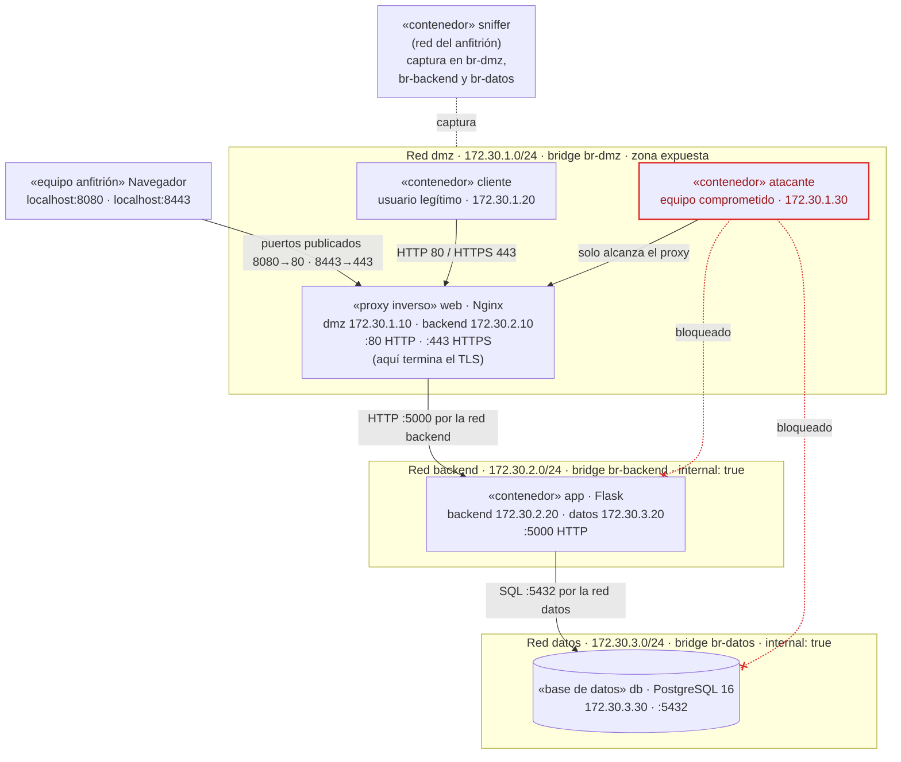

# l5_2b — Patrón de Segmentación de Red

### Laboratorio 5 — Seguridad

**Arquitectura de Software 2026-II · Universidad Nacional de Colombia — Sede Bogotá**<br>
**Docente:** Jeisson Andrés Vergara Vargas

---

## 1. Equipo

- **Nombre del equipo:** 2b
- **Integrantes:**
    - Santiago Zamora Garzon
    - Esteban Andrés Gómez Álvarez
    - Jose Arturo Herrera Rivera
    - Juan David Suárez Coronado
    - Nicole Ariadna Celemin Triana
    - José Alejandro Solano Garcés
    - Jaisson Andrés Machado Bautista
    - Ángel David Ruiz Barbosa

---

## 2. Patrón de segmentación de red

### 2.1. Objetivo del laboratorio

Demostrar que la segmentación de red limita lo que un atacante puede alcanzar y observar. Se monta la misma aplicación (proxy Nginx, aplicación Flask y base de datos PostgreSQL) en dos topologías con Docker Compose y se compara qué logra un equipo comprometido en cada una.

- **Red plana:** todos los contenedores comparten una red. El atacante llega directo a la base de datos y lee todo su contenido.
- **Red segmentada:** tres zonas (DMZ, backend, datos). El atacante solo alcanza el proxy.
- **Inspección del canal:** se captura el tráfico de un inicio de sesión por HTTP (sin cifrar) y por HTTPS (cifrado con un certificado de OpenSSL), en cada segmento.

La conclusión que se busca es la defensa en profundidad: la segmentación decide quién puede llegar al tráfico, y el cifrado protege su contenido si alguien llega.

**Alcance:** todas las pruebas se hacen contra los contenedores del propio laboratorio. Capturar tráfico de redes ajenas sin autorización es ilegal.

### 2.2. Descripción y propósito del patrón

El **patrón de segmentación de red** divide la red en zonas según su nivel de confianza y solo permite los flujos necesarios entre ellas, a través de puntos controlados. Su propósito es que comprometer un componente expuesto no dé acceso al resto del sistema: limita el movimiento lateral, reduce la superficie de ataque y contiene el daño.

En este laboratorio el patrón se implementa con redes de Docker Compose:

- Una red bridge por zona: DMZ (expuesta), backend (aplicación) y datos (base de datos).
- `internal: true` en backend y datos: sin salida a Internet ni puertos publicados.
- Servicios conectados a dos zonas como únicos puentes controlados: `web` (DMZ↔backend) y `app` (backend↔datos).
- El DNS interno de Docker y sus reglas de aislamiento entre bridges impiden, por nombre y por IP, cualquier flujo no declarado.

---

## 3. Escenario de calidad

Atributo: **confidencialidad**, y de forma secundaria integridad, de los datos de usuarios.

| Elemento | Descripción |
| --- | --- |
| Fuente | Atacante externo que compromete un equipo dentro de la DMZ |
| Estímulo | Intenta descubrir y conectarse directamente a la aplicación y a la base de datos, y capturar credenciales en tránsito |
| Artefacto | Aplicación Flask y base de datos PostgreSQL con la tabla `usuarios` |
| Entorno | Operación normal, sistema desplegado con Docker Compose |
| Respuesta | La red no enruta ni resuelve los servicios internos para el equipo comprometido; desde la DMZ solo el proxy es alcanzable, y solo el proxy llega a la app. El tramo expuesto viaja cifrado con TLS |
| Medida de respuesta | 0 de 2 servicios internos alcanzables desde el equipo comprometido (100 % de conexiones bloqueadas, por nombre y por IP); ningún contenedor distinto de `app` llega a la base de datos; 0 credenciales legibles en la captura de la DMZ con HTTPS |

---

## 4. Vista arquitectónica (despliegue)



Línea continua: flujo permitido. Línea punteada roja: conexión bloqueada por la segmentación (comprobado en la sección 5.5). Línea punteada gris: punto de captura usado en la sección 5.6.

Cada contenedor se conecta solo a las zonas que necesita. El proxy `web` es el único puente entre la DMZ y el backend, y `app` el único entre el backend y los datos. Las redes `backend` y `datos` son internas: no tienen salida a Internet.

| Contenedor | Zona(s) | IP | Rol |
| --- | --- | --- | --- |
| web | DMZ + backend | 172.30.1.10 / 172.30.2.10 | Proxy Nginx, puertos 8080 (HTTP) y 8443 (HTTPS) en el equipo |
| app | backend + datos | 172.30.2.20 / 172.30.3.20 | Aplicación Flask con `/login` |
| db | datos | 172.30.3.30 | PostgreSQL con la tabla `usuarios` |
| cliente | DMZ | 172.30.1.20 | Usuario legítimo que inicia sesión |
| atacante | DMZ | 172.30.1.30 | Equipo comprometido |
| sniffer | red del anfitrión | — | Captura en `br-dmz`, `br-backend` y `br-datos` |

---

## 5. Implementación

### 5.1. Requisitos

- Docker Engine con el plugin Compose v2 (Linux), o Docker Desktop (Windows/Mac). Verificar con `docker compose version`.
- Internet la primera vez, para descargar `nginx:1.27-alpine`, `postgres:16-alpine`, `python:3.12-slim` y `alpine:3.20`.
- Puertos 8080 y 8443 libres en el equipo.
- OpenSSL para generar el certificado. En Windows viene con Git Bash.
- Opcional: Wireshark, para abrir las capturas `.pcap`.
- Una terminal Bash (en Windows, Git Bash o WSL). Todos los comandos se ejecutan dentro de la carpeta `lab-segmentacion`.

### 5.2. Archivos y configuración

Los archivos están en la carpeta `lab-segmentacion/` de la entrega.

```
lab-segmentacion/
├── docker-compose.yml          <- red SEGMENTADA (dmz, backend, datos)
├── docker-compose.plano.yml    <- red PLANA (una sola red)
├── nginx/
│   ├── nginx.conf              <- proxy: HTTP 80 y HTTPS 443
│   ├── generar-certs.sh        <- certificado autofirmado con OpenSSL
│   └── certs/
├── app/  (Dockerfile, app.py)  <- aplicación Flask con /login
├── db/init.sql                 <- tabla usuarios con datos de prueba
├── atacante/Dockerfile         <- curl, nmap, tcpdump, ngrep, psql, openssl
└── capturas/                   <- aquí quedan los .pcap
```

#### 5.2.1. docker-compose.yml (red segmentada)

La clave está en `networks`: cada servicio se conecta solo a las zonas que necesita, y `backend` y `datos` son `internal: true`. Los nombres de bridge fijos (`br-dmz`, `br-backend`, `br-datos`) permiten capturar en cada segmento.

```yaml
# Laboratorio de segmentación de red — versión SEGMENTADA
# Tres zonas: DMZ (pública), BACKEND (aplicación) y DATOS (base de datos).
name: lab-segmentado

services:
  web:                         # Proxy inverso Nginx: única puerta de entrada
    image: nginx:1.27-alpine
    restart: unless-stopped
    volumes:
      - ./nginx/nginx.conf:/etc/nginx/conf.d/default.conf:ro
      - ./nginx/certs:/etc/nginx/certs:ro
    ports:
      - "8080:80"              # HTTP  (sin cifrar)
      - "8443:443"             # HTTPS (cifrado con TLS)
    networks:
      dmz:     { ipv4_address: 172.30.1.10 }
      backend: { ipv4_address: 172.30.2.10 }
    depends_on: [app]

  app:                         # Aplicación Flask: solo en BACKEND y DATOS
    build: ./app
    restart: unless-stopped
    environment:
      DATABASE_URL: postgresql://tienda:Tienda2026@db:5432/tienda
    networks:
      backend: { ipv4_address: 172.30.2.20 }
      datos:   { ipv4_address: 172.30.3.20 }
    depends_on: [db]

  db:                          # PostgreSQL: solo en la zona DATOS
    image: postgres:16-alpine
    environment:
      POSTGRES_DB: tienda
      POSTGRES_USER: tienda
      POSTGRES_PASSWORD: Tienda2026
    volumes:
      - ./db/init.sql:/docker-entrypoint-initdb.d/init.sql:ro
    networks:
      datos: { ipv4_address: 172.30.3.30 }

  cliente:                     # Usuario legítimo que inicia sesión
    build: ./atacante
    command: sleep infinity
    networks:
      dmz: { ipv4_address: 172.30.1.20 }

  atacante:                    # Equipo comprometido dentro de la DMZ
    build: ./atacante
    command: sleep infinity
    networks:
      dmz: { ipv4_address: 172.30.1.30 }

  sniffer:                     # Punto de captura en los switches virtuales (como un puerto espejo)
    build: ./atacante
    network_mode: host
    cap_add: [NET_ADMIN, NET_RAW]
    volumes:
      - ./capturas:/capturas
    profiles: ["captura"]      # solo se crea con: docker compose run --rm sniffer ...

networks:
  dmz:
    driver: bridge
    driver_opts:
      com.docker.network.bridge.name: br-dmz
    ipam:
      config: [{ subnet: 172.30.1.0/24 }]
  backend:
    driver: bridge
    internal: true             # sin salida a Internet ni puertos publicados
    driver_opts:
      com.docker.network.bridge.name: br-backend
    ipam:
      config: [{ subnet: 172.30.2.0/24 }]
  datos:
    driver: bridge
    internal: true
    driver_opts:
      com.docker.network.bridge.name: br-datos
    ipam:
      config: [{ subnet: 172.30.3.0/24 }]
```

#### 5.2.2. docker-compose.plano.yml (red plana)

```yaml
# Laboratorio de segmentación de red — versión PLANA (SIN segmentar)
# Todos los contenedores comparten una sola red: así NO se debe hacer.
name: lab-plano

services:
  web:
    image: nginx:1.27-alpine
    restart: unless-stopped
    volumes:
      - ./nginx/nginx.conf:/etc/nginx/conf.d/default.conf:ro
      - ./nginx/certs:/etc/nginx/certs:ro
    ports: ["8080:80", "8443:443"]
    networks: { plana: { ipv4_address: 172.31.0.10 } }
    depends_on: [app]

  app:
    build: ./app
    restart: unless-stopped
    environment:
      DATABASE_URL: postgresql://tienda:Tienda2026@db:5432/tienda
    networks: { plana: { ipv4_address: 172.31.0.20 } }
    depends_on: [db]

  db:
    image: postgres:16-alpine
    environment:
      POSTGRES_DB: tienda
      POSTGRES_USER: tienda
      POSTGRES_PASSWORD: Tienda2026
    volumes:
      - ./db/init.sql:/docker-entrypoint-initdb.d/init.sql:ro
    networks: { plana: { ipv4_address: 172.31.0.30 } }

  cliente:
    build: ./atacante
    command: sleep infinity
    networks: { plana: { ipv4_address: 172.31.0.40 } }

  atacante:
    build: ./atacante
    command: sleep infinity
    networks: { plana: { ipv4_address: 172.31.0.50 } }

networks:
  plana:
    driver: bridge
    driver_opts:
      com.docker.network.bridge.name: br-plana
    ipam:
      config: [{ subnet: 172.31.0.0/24 }]
```

#### 5.2.3. nginx/nginx.conf

```nginx
# Puerto 80: HTTP sin cifrar (solo para la demostración)
server {
    listen 80;
    server_name web.lab.local;
    location / {
        proxy_pass http://app:5000;
        proxy_set_header Host $host;
        proxy_set_header X-Real-IP $remote_addr;
    }
}

# Puerto 443: HTTPS con el certificado generado con OpenSSL
server {
    listen 443 ssl;
    server_name web.lab.local;

    ssl_certificate     /etc/nginx/certs/web.crt;
    ssl_certificate_key /etc/nginx/certs/web.key;
    ssl_protocols       TLSv1.2 TLSv1.3;

    location / {
        proxy_pass http://app:5000;
        proxy_set_header Host $host;
        proxy_set_header X-Real-IP $remote_addr;
        proxy_set_header X-Forwarded-Proto https;
    }
}
```

#### 5.2.4. nginx/generar-certs.sh

```bash
#!/bin/sh
# Genera un certificado autofirmado para el proxy (válido 365 días)
# Evita que Git Bash (Windows) convierta "/C=CO/..." en una ruta de Windows
export MSYS_NO_PATHCONV=1
cd "$(dirname "$0")/certs"
openssl req -x509 -nodes -newkey rsa:2048 -days 365 \
  -keyout web.key -out web.crt \
  -subj "/C=CO/O=Laboratorio Seguridad/CN=web.lab.local" \
  -addext "subjectAltName=DNS:web.lab.local,DNS:web,DNS:localhost"
chmod 644 web.key web.crt
openssl x509 -in web.crt -noout -subject -dates
```

#### 5.2.5. app/Dockerfile y app/app.py

```dockerfile
FROM python:3.12-slim
WORKDIR /app
RUN pip install --no-cache-dir flask==3.0.3 "psycopg[binary]==3.2.3"
COPY app.py .
EXPOSE 5000
CMD ["flask", "--app", "app", "run", "--host", "0.0.0.0", "--port", "5000"]
```

```python
import os
import psycopg
from flask import Flask, request

app = Flask(__name__)
DSN = os.environ["DATABASE_URL"]

FORM = """<h2>Tienda del laboratorio</h2>
<form method="post" action="/login">
  Usuario <input name="usuario"> Clave <input name="clave" type="password">
  <button>Entrar</button>
</form>"""


@app.get("/")
def inicio():
    return FORM


@app.post("/login")
def login():
    usuario = request.form.get("usuario", "")
    clave = request.form.get("clave", "")
    with psycopg.connect(DSN) as conn:
        fila = conn.execute(
            "SELECT nombre FROM usuarios WHERE usuario = %s AND clave = %s",
            (usuario, clave),
        ).fetchone()
    if fila:
        return f"Bienvenida, {fila[0]}\n"
    return "Usuario o clave incorrectos\n", 401
```

#### 5.2.6. db/init.sql

```sql
CREATE TABLE usuarios (
    id      SERIAL PRIMARY KEY,
    usuario TEXT UNIQUE NOT NULL,
    clave   TEXT NOT NULL,          -- en texto plano a propósito (laboratorio)
    nombre  TEXT NOT NULL
);

INSERT INTO usuarios (usuario, clave, nombre) VALUES
  ('ana',   'Ana2026*',   'Ana Pérez'),
  ('luis',  'Luis#4321',  'Luis Gómez'),
  ('admin', 'Admin!2026', 'Administrador');
```

#### 5.2.7. atacante/Dockerfile

La misma imagen sirve para `cliente`, `atacante` y `sniffer`.

```dockerfile
FROM alpine:3.20
RUN apk add --no-cache curl nmap nmap-scripts tcpdump ngrep openssl \
    postgresql16-client bind-tools iputils netcat-openbsd iproute2
CMD ["sleep", "infinity"]
```

### 5.3. Paso 0: generar el certificado con OpenSSL

```bash
cd lab-segmentacion
sh nginx/generar-certs.sh
```

Si no tienes OpenSSL, genera el certificado con un contenedor:

```bash
docker run --rm -v "$PWD/nginx/certs:/certs" -w /certs alpine/openssl req -x509 -nodes \
  -newkey rsa:2048 -days 365 -keyout web.key -out web.crt -subj "/CN=web.lab.local" \
  -addext "subjectAltName=DNS:web.lab.local,DNS:web,DNS:localhost"
```

### 5.4. Parte 1: red plana (sin segmentar)

En la red plana, el atacante ve todos los servicios y llega directo a la base de datos, saltándose el proxy y la aplicación.

1. Con el certificado ya generado (sección 5.3), levantar el escenario:

   ```bash
   docker compose -f docker-compose.plano.yml up -d --build
   docker compose -f docker-compose.plano.yml ps
   ```

2. Comprobar que la aplicación funciona: abrir `http://localhost:8080` en el navegador e iniciar sesión con `ana` / `Ana2026*`.

3. Reconocimiento desde el atacante. Escanear la red buscando los puertos del laboratorio:

   ```bash
   docker compose -f docker-compose.plano.yml exec atacante \
     nmap -sT -p 80,443,5000,5432 172.31.0.0/24
   ```

   **Esperado:** aparecen abiertos 80/443 (web), 5000 (app) y 5432 (db). Toda la infraestructura está expuesta.

4. Saltarse el proxy y hablar directo con la aplicación:

   ```bash
   docker compose -f docker-compose.plano.yml exec atacante curl -s http://app:5000/
   ```

   **Esperado:** responde el formulario. Cualquier control que pusiéramos en el proxy (como un WAF) quedaría evadido.

5. Conectarse a la base de datos. Suponemos que las credenciales se filtraron de un archivo de configuración (un caso frecuente):

   ```bash
   docker compose -f docker-compose.plano.yml exec -e PGPASSWORD=Tienda2026 atacante \
     psql -h db -U tienda -d tienda -c "SELECT usuario, clave FROM usuarios;"
   ```

   **Esperado:** se listan los tres usuarios con sus claves. En la red plana, una credencial filtrada basta para llegar a los datos.

6. Apagar el escenario antes de seguir:

   ```bash
   docker compose -f docker-compose.plano.yml down -v
   ```

### 5.5. Parte 2: red segmentada

Con segmentación, el atacante en la DMZ solo alcanza el proxy: no resuelve ni conecta con la aplicación ni con la base de datos, ni siquiera por IP.

1. Levantar el escenario:

   ```bash
   docker compose up -d --build
   docker network ls --filter name=lab-segmentado
   docker network inspect lab-segmentado_backend --format '{{.Internal}}'   # true
   ```

2. Repetir el reconocimiento desde el atacante, ahora sobre las tres subredes:

   ```bash
   docker compose exec atacante nmap -sT -Pn -p 80,443,5000,5432 \
     172.30.1.10 172.30.2.20 172.30.3.30
   ```

   **Esperado:** 172.30.1.10 (web) muestra 80 y 443 abiertos; app y db aparecen `filtered`.

3. Intentar llegar a la aplicación y a la base de datos por nombre y por IP:

   ```bash
   docker compose exec atacante nc -zv -w 3 app 5000          # no resuelve el nombre
   docker compose exec atacante nc -zv -w 3 172.30.2.20 5000  # timeout
   docker compose exec -e PGPASSWORD=Tienda2026 -e PGCONNECT_TIMEOUT=5 atacante \
     psql -h 172.30.3.30 -U tienda -d tienda -c "SELECT 1;"   # timeout
   ```

   Aunque el atacante tenga la contraseña filtrada, no hay camino de red hasta la base de datos.

4. Confirmar que los flujos permitidos sí funcionan:

   ```bash
   docker compose exec cliente curl -s -X POST http://web/login -d "usuario=ana&clave=Ana2026*"
   docker compose exec web wget -qO- http://app:5000/       # web -> app: permitido
   docker compose exec web timeout 3 wget -qO- http://172.30.3.30:5432   # web -> db: bloqueado
   ```

5. Comprobar que las zonas internas no salen a Internet:

   ```bash
   docker compose exec app python -c "import urllib.request; urllib.request.urlopen('https://example.com', timeout=5)"
   ```

   **Esperado:** `Temporary failure in name resolution`. Si la app se compromete, no puede sacar datos ni descargar herramientas.

#### Matriz de alcance esperada

| Origen | web (80/443) | app (5000) | db (5432) | Internet |
| --- | --- | --- | --- | --- |
| atacante (DMZ) | Sí | No | No | Sí |
| web (DMZ + backend) | — | Sí | No | Sí |
| app (backend + datos) | Sí | — | Sí | No |
| atacante en red plana | Sí | Sí | Sí | Sí |

El atacante no resuelve `app` ni `db` porque el DNS interno de Docker solo responde nombres de las redes a las que el contenedor está conectado. El tráfico por IP lo bloquean las reglas de aislamiento que Docker crea entre bridges.

### 5.6. Parte 3: captura del canal sin cifrar y cifrado

Por HTTP la contraseña se lee en la captura de la DMZ; por HTTPS no. Pero detrás del proxy viaja en claro, y por eso esos segmentos deben quedar fuera del alcance del atacante.

El servicio `sniffer` captura directamente en los bridges de Docker (`br-dmz`, `br-backend`, `br-datos`), como un puerto espejo en un switch. Representa a alguien con acceso privilegiado a un segmento. Se necesitan **dos terminales**, ambas en la carpeta `lab-segmentacion` y con el escenario segmentado arriba.

#### 5.6.1. Canal sin cifrar (HTTP)

1. Terminal 1, empezar a capturar en la DMZ:

   ```bash
   docker compose run --rm sniffer tcpdump -l -i br-dmz -nn -A -s0 'tcp port 80'
   ```

2. Terminal 2, el cliente inicia sesión por HTTP:

   ```bash
   docker compose exec cliente curl -s -X POST http://web/login -d "usuario=ana&clave=Ana2026*"
   ```

3. **Esperado en la terminal 1:** la petición completa en texto legible, terminando en `usuario=ana&clave=Ana2026*`.

Para filtrar solo la línea con la clave, usa `ngrep`:

```bash
docker compose run --rm sniffer ngrep -l -d br-dmz -q -W byline 'clave' 'tcp port 80'
```

#### 5.6.2. Canal cifrado (HTTPS)

1. Terminal 1, capturar ahora el puerto 443:

   ```bash
   docker compose run --rm sniffer tcpdump -l -i br-dmz -nn -A -s0 'tcp port 443'
   ```

2. Terminal 2, el mismo inicio de sesión por HTTPS (`-k` acepta el certificado autofirmado):

   ```bash
   docker compose exec cliente curl -sk -X POST https://web/login -d "usuario=ana&clave=Ana2026*"
   ```

3. **Esperado:** se ven varios paquetes, pero todo el contenido es ilegible. En el saludo TLS solo aparece el nombre del servidor (SNI); no aparecen la ruta `/login`, el usuario ni la clave.

4. Inspeccionar el canal TLS que se negoció:

   ```bash
   docker compose exec cliente sh -c \
     "openssl s_client -connect web:443 -servername web.lab.local </dev/null 2>/dev/null | grep -E 'subject=|Protocol|Cipher'"
   ```

   **Esperado:** el sujeto `CN = web.lab.local`, protocolo `TLSv1.3` y un cifrado como `TLS_AES_256_GCM_SHA384`.

#### 5.6.3. Qué pasa detrás del proxy

Nginx descifra el TLS y reenvía la petición a la app por HTTP. La app consulta PostgreSQL sin cifrar. Repite el inicio de sesión **por HTTPS** (punto 2 de la sección 5.6.2) mientras capturas en cada segmento interno:

```bash
docker compose run --rm sniffer tcpdump -l -i br-backend -nn -A -s0 'tcp port 5000'
docker compose run --rm sniffer tcpdump -l -i br-datos   -nn -A -s0 'tcp port 5432'
```

**Esperado:** en `br-backend` aparece `usuario=ana&clave=Ana2026*` en claro; en `br-datos`, la consulta `SELECT nombre FROM usuarios ...` con `ana` y `Ana2026*` como parámetros. Aquí está el valor de la segmentación: el atacante de la DMZ no tiene acceso a esos segmentos. La mejora siguiente sería cifrar también el tramo interno (proxy→app y app→db), que conecta con el patrón de canal seguro.

#### 5.6.4. Guardar la evidencia para Wireshark

```bash
docker compose run --rm sniffer tcpdump -U -i br-dmz -nn -s0 -w /capturas/dmz-http.pcap 'tcp port 80'
docker compose run --rm sniffer tcpdump -U -i br-dmz -nn -s0 -w /capturas/dmz-https.pcap 'tcp port 443'
```

Ejecuta cada una, haz el inicio de sesión correspondiente y detén con Ctrl+C (la opción `-U` escribe cada paquete al instante, así el archivo no queda vacío). Los archivos quedan en `capturas/`. En Wireshark, usa clic derecho → Seguir → Flujo TCP: en el de HTTP se lee la clave; en el de HTTPS solo hay `Application Data`. El filtro `tls.handshake.type == 1` muestra el saludo TLS.

**Si usas Docker Desktop y `br-dmz` no aparece**, captura desde el espacio de red del proxy:

```bash
docker run --rm --net container:lab-segmentado-web-1 --cap-add NET_RAW \
  lab-segmentado-atacante tcpdump -i any -nn -A -s0 'tcp port 80 or tcp port 5000'
```

---

## 6. Resultados observados

| Prueba | Red plana | Red segmentada |
| --- | --- | --- |
| El atacante ve app y db con nmap | Sí, puertos abiertos | No, aparecen `filtered` |
| El atacante se salta el proxy | Sí | No |
| El atacante lee la base de datos | Sí | No, ni con la contraseña |

| Captura en la red segmentada | Login por HTTP | Login por HTTPS |
| --- | --- | --- |
| `br-dmz` (cliente → proxy) | Clave visible | Ilegible |
| `br-backend` (proxy → app) | Clave visible | Clave visible |
| `br-datos` (app → db) | Consulta y clave visibles | Consulta y clave visibles |

La segmentación reduce quién puede llegar a los servicios y al tráfico interno. El cifrado protege el contenido en el tramo expuesto. Juntos son defensa en profundidad.

---

## 7. Recomendaciones para otros equipos

1. **Diseñen las zonas desde los flujos.** Listen qué componente necesita hablar con cuál y en qué puerto; cada servicio va solo en las redes de esos flujos.
2. **Marquen como `internal: true` toda red que no necesite Internet**, sobre todo la de datos. No publiquen puertos (`ports`) de la app ni de la base de datos.
3. **Un solo punto de entrada.** Solo el proxy publica puertos; así un WAF o un control de acceso en el proxy no se puede evadir.
4. **Fijen subredes e IPs** (`ipam`) y nombres de bridge. Facilitan las pruebas, la documentación y la captura de tráfico.
5. **Verifiquen el aislamiento con pruebas negativas**: nmap, `nc` y `psql` desde la zona expuesta deben fallar por nombre y por IP. Que algo funcione no demuestra que el resto esté bloqueado.
6. **Combinen segmentación y cifrado.** La segmentación no protege el contenido: detrás del proxy el tráfico viaja en claro. Si el modelo de amenazas lo exige, cifren también proxy→app y app→db (patrón de canal seguro).
7. **Saquen las credenciales del compose** con archivos `.env` o secretos de Docker, que no se suban al repositorio.
8. **Para aplicarlo a su proyecto**, reemplacen `app` y `db` por sus servicios, conserven las tres redes y repitan las pruebas de las secciones 5.5 y 5.6.

---

## 8. Limpieza y problemas comunes

### 8.1. Limpieza

```bash
docker compose --profile captura down -v --remove-orphans   # incluye capturas que quedaron abiertas
docker compose -f docker-compose.plano.yml down -v
docker image prune -f   # opcional: borra imágenes sin uso
```

### 8.2. Problemas comunes

| Síntoma | Causa | Solución |
| --- | --- | --- |
| Nginx se reinicia en bucle | Falta el certificado | Ejecutar la sección 5.3 (`generar-certs.sh`) y `docker compose restart web` |
| `Bind for 0.0.0.0:8080 failed` | Puerto ocupado, o el otro escenario sigue arriba | Apagar el otro escenario, o cambiar `8080:80` por otro puerto, por ejemplo `8081:80` |
| `502 Bad Gateway` o error al iniciar sesión | La base de datos aún inicia | Esperar 10 segundos; revisar `docker compose logs db` |
| `Pool overlaps with other one` | Ya existe una red con 172.30.x o 172.31.x | Cambiar las subredes en el compose o borrar la red con `docker network prune` |
| `tcpdump: br-dmz: No such device` | El escenario no está arriba, o Docker Desktop | Hacer `docker compose up -d`; si persiste, usar la captura alternativa de 5.6.4 |
| En Git Bash, `/capturas/...` o `/certs` aparecen como `C:/Program Files/Git/...` | Git Bash convierte las rutas que empiezan por `/` | Anteponer `MSYS_NO_PATHCONV=1` al comando, por ejemplo `MSYS_NO_PATHCONV=1 docker compose run ...` |
| `generar-certs.sh` falla en Windows | Fin de línea CRLF o sin OpenSSL | Ejecutarlo en Git Bash, o usar la alternativa con contenedor de la sección 5.3 |
| Queda un contenedor `sniffer-run` encendido | Se cerró la terminal sin Ctrl+C | `docker compose --profile captura down --remove-orphans` |
| Cambios en `init.sql` no se aplican | La base ya estaba creada | `docker compose down -v` y volver a levantar |
